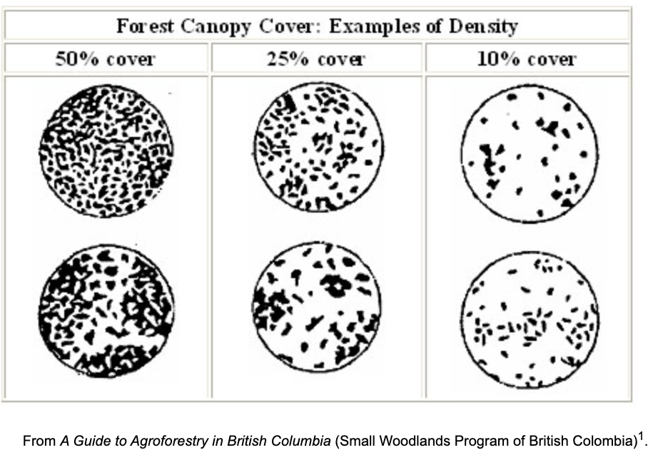

```{python}
#| label: setup
import numpy as np
import pandas as pd
import plotly.express as px
import plotly.graph_objects as go
import plotly.io as pio
import matplotlib.pyplot as plt
import geopandas as gpd
import h3
from plotly.subplots import make_subplots
from shapely.geometry import Polygon
from h3.api import basic_int as h3_int
import folium

import report_utils as ru
from report_utils import fmt

pio.renderers.default = "plotly_mimetype+notebook_connected"
plt.rcParams.update({"font.size": 10, "figure.dpi": 110})
ECOREGION_COLORS = ru.ecoregion_colors()
T = ru.PLOT_TEMPLATE
N = {}  # numbers quoted in the text

# ---- Hansen, wall-to-wall
hansen = ru.hansen_table()
long = ru.hansen_long()
land_ha = hansen["land_ha"].sum()
forest_2000 = hansen["forest2000_gt30_ha"].sum()
annual_loss = ru.national_loss_by_year(hansen)
loss_2001_2025 = annual_loss.sum()
loss_2013_2025 = annual_loss.loc[2013:].sum()
loss_2020_2025 = annual_loss.loc[2020:].sum()
N.update(
    land=fmt(land_ha), forest_2000=fmt(forest_2000), forest_2000_m=fmt(forest_2000 / 1e6, 2),
    loss_all=fmt(loss_2001_2025), loss_all_m=fmt(loss_2001_2025 / 1e6, 2),
    loss_all_pct=fmt(100 * loss_2001_2025 / forest_2000, 1),
    loss_2013=fmt(loss_2013_2025), loss_2013_m=fmt(loss_2013_2025 / 1e6, 2),
    loss_2013_pct=fmt(100 * loss_2013_2025 / forest_2000, 1),
    loss_2020=fmt(loss_2020_2025), forest_2025=fmt(forest_2000 - loss_2001_2025),
    forest_2025_m=fmt((forest_2000 - loss_2001_2025) / 1e6, 2),
    forest_2025_pct=fmt(100 * (forest_2000 - loss_2001_2025) / land_ha, 1),
)
mean_early = annual_loss.loc[:2012].mean()
mean_2013 = annual_loss.loc[2013:].mean()
mean_2020 = annual_loss.loc[2020:].mean()
mean_2013_2019 = annual_loss.loc[2013:2019].mean()
N.update(mean_early=fmt(mean_early), mean_2013=fmt(mean_2013), mean_2020=fmt(mean_2020),
         mean_2013_2019=fmt(mean_2013_2019), jump=fmt(mean_2013 / mean_early, 1),
         peak_year=str(annual_loss.idxmax()), peak=fmt(annual_loss.max()))

# Canopy thresholds
losses = long[long["lossyear"] > 0]
thresholds = pd.DataFrame({
    "forest_2000_ha": long.groupby("threshold")["area_ha"].sum(),
    "loss_2013_2025_ha": losses[losses["year"] >= 2013].groupby("threshold")["area_ha"].sum(),
})
thresholds["share_%"] = 100 * thresholds["forest_2000_ha"] / land_ha
for t in ru.CANOPY_THRESHOLDS:
    N[f"forest_t{t}_m"] = fmt(thresholds.loc[t, "forest_2000_ha"] / 1e6, 2)
    N[f"forest_t{t}_pct"] = fmt(thresholds.loc[t, "share_%"])
    N[f"loss_t{t}_m"] = fmt(thresholds.loc[t, "loss_2013_2025_ha"] / 1e6, 2)
by_eco_threshold = long.groupby(["ECO_NAME", "threshold"])["area_ha"].sum().unstack()
N["sav_t10_m"] = fmt(by_eco_threshold.loc["West Sudanian savanna", 10] / 1e6, 2)
N["sav_t30"] = fmt(by_eco_threshold.loc["West Sudanian savanna", 30])

# Ecoregions
eco = ru.ecoregion_forest()
eco["forest_cover_2025_%"] = 100 * eco["forest_2025_ha"] / eco["land_ha"]
eco["share_forest_2025_%"] = 100 * eco["forest_2025_ha"] / eco["forest_2025_ha"].sum()
eco["annual_2013_2019_ha"] = eco["loss_2013_2019_ha"] / 7
eco["annual_2020_2025_ha"] = eco["loss_2020_2025_ha"] / 6
eco["change_annual_%"] = 100 * (eco["annual_2020_2025_ha"] / eco["annual_2013_2019_ha"] - 1)
loss_by_year, rate_by_year = ru.loss_rates()
rates = pd.DataFrame({
    "2013–2025": rate_by_year.loc[:, 2013:].mean(axis=1),
    "2013–2019": rate_by_year.loc[:, 2013:2019].mean(axis=1),
    "2020–2025": rate_by_year.loc[:, 2020:].mean(axis=1),
})
fs, lw, mt, sv, mg = ("Guinean forest-savanna", "Western Guinean lowland forests", "Guinean montane forests",
                      "West Sudanian savanna", "Guinean mangroves")
N.update(
    fs_forest=fmt(eco.loc[fs, "forest_2025_ha"]), fs_share=fmt(eco.loc[fs, "share_forest_2025_%"]),
    lw_forest=fmt(eco.loc[lw, "forest_2025_ha"]), lw_share=fmt(eco.loc[lw, "share_forest_2025_%"]),
    lw_cover=fmt(eco.loc[lw, "forest_cover_2025_%"]), sv_cover=fmt(eco.loc[sv, "forest_cover_2025_%"], 1),
    rate_guinea=fmt(rates.loc["Guinea", "2013–2025"], 1), rate_guinea_2020=fmt(rates.loc["Guinea", "2020–2025"], 1),
    rate_lw_2020=fmt(rates.loc[lw, "2020–2025"], 2), rate_sv_2013=fmt(rates.loc[sv, "2013–2019"], 1),
    rate_sv_2020=fmt(rates.loc[sv, "2020–2025"], 1),
    fs_change=fmt(eco.loc[fs, "change_annual_%"]), lw_change=fmt(eco.loc[lw, "change_annual_%"]),
    mt_change=fmt(eco.loc[mt, "change_annual_%"]), mg_change=fmt(eco.loc[mg, "change_annual_%"]),
    sv_change=fmt(eco.loc[sv, "change_annual_%"]),
    nat_decline=fmt(100 * (1 - mean_2020 / mean_2013_2019)),
)
forested = rates.drop(index=["Guinea", sv])
N["rate_min"], N["rate_max"] = fmt(forested["2013–2025"].min(), 1), fmt(forested["2013–2025"].max(), 1)

# ---- Resolution-8 hexagons
fine = ru.fine_hexagons()
fine["annual_2013_2025"] = fine["loss_2013_2025_ha"] / 13
fine["annual_2013_2019"] = fine["loss_2013_2019_ha"] / 7
fine["annual_2020_2025"] = fine["loss_2020_2025_ha"] / 6
fine["annual_change"] = fine["annual_2020_2025"] - fine["annual_2013_2019"]
curves = {}
for period, column in [("2013–2025", "loss_2013_2025_ha"), ("2020–2025", "loss_2020_2025_ha")]:
    curves[(period, "land")] = ru.concentration_curve(fine, column, "land_ha")
    curves[(period, "forest")] = ru.concentration_curve(fine, column, "forest_2012_ha")
for period in ("2013–2025", "2020–2025"):
    key = period[:4] if period.startswith("2013") else "2020"
    for share in (10, 25, 40, 50):
        N[f"conc_{key}_land_{share}"] = fmt(ru.share_at(curves[(period, "land")], share))
        N[f"conc_{key}_forest_{share}"] = fmt(ru.share_at(curves[(period, "forest")], share))
N["no_loss_land"] = fmt(100 * fine.loc[fine["loss_2013_2025_ha"] == 0, "land_ha"].sum() / land_ha)
N["no_loss_land_2020"] = fmt(100 * fine.loc[fine["loss_2020_2025_ha"] == 0, "land_ha"].sum() / land_ha)
hot = {"2013–2025": ru.hotspot_classes(fine["loss_2013_2025_ha"]), "2020–2025": ru.hotspot_classes(fine["loss_2020_2025_ha"])}
for period, classes in hot.items():
    key = "2013" if period.startswith("2013") else "2020"
    N[f"core_land_{key}"] = fmt(100 * fine.loc[classes == 3, "land_ha"].sum() / land_ha, 1)
    N[f"hot_land_{key}"] = fmt(100 * fine.loc[classes >= 2, "land_ha"].sum() / land_ha, 1)
N["n_hex"] = fmt(len(fine))
decreasing = fine["annual_change"] < -0.1
increasing = fine["annual_change"] > 0.1
N["hex_down"] = fmt(100 * decreasing.mean())
N["hex_up"] = fmt(100 * increasing.mean())

# ---- Official figures
NERF_DEFORESTATION_HA = {2016: 99_057, 2017: 22_908, 2018: 104_242, 2019: 64_695, 2020: 22_908, 2021: 30_333,
                         2022: 62_455, 2023: 125_362, 2024: 41_787}
nerf_mean = np.mean(list(NERF_DEFORESTATION_HA.values()))
hansen_2016_2024 = annual_loss.loc[2016:2024].mean()
N.update(nerf_mean=fmt(round(nerf_mean, -2)), hansen_nerf=fmt(hansen_2016_2024),
         hansen_vs_nerf=fmt(hansen_2016_2024 / nerf_mean, 1))
FRA_2020_HA = {2000: 6_929_000, 2010: 6_569_000, 2015: 6_389_000, 2020: 6_189_000}

# ---- Land-cover benchmark
points, forest_pts, lulc_pts = ru.benchmark()
weights = points["weight_km2"] * ru.HA_PER_KM2
total_ha = weights.sum()
N.update(n_points=fmt(len(points)), sample_area=fmt(total_ha))
forest_rows = []
for name in forest_pts.columns:
    area, se = ru.area_estimate(forest_pts[name], weights)
    forest_rows.append({"product": name, "forest_ha": area, "ci95_ha": 1.96 * se, "share_%": 100 * area / total_ha,
                        "group": "10 m land cover" if name in lulc_pts.columns else "Forest product"})
forest_areas = pd.DataFrame(forest_rows).sort_values("forest_ha").set_index("product")
N.update(fa_min=fmt(forest_areas["forest_ha"].min() / 1e6, 1), fa_max=fmt(forest_areas["forest_ha"].max() / 1e6, 1),
         fa_hansen=fmt(forest_areas.loc["Hansen GFC (> 30 %)", "forest_ha"] / 1e6, 2),
         fa_hansen10=fmt(forest_areas.loc["Hansen GFC (> 10 %)", "forest_ha"] / 1e6, 1),
         fa_wc=fmt(forest_areas.loc["ESA WorldCover", "forest_ha"] / 1e6, 1),
         fa_esri=fmt(forest_areas.loc["Esri LULC", "forest_ha"] / 1e6, 1),
         fa_dw=fmt(forest_areas.loc["Dynamic World", "forest_ha"] / 1e6, 1),
         fa_gfc=fmt(forest_areas.loc["JRC GFC2020", "forest_ha"] / 1e6, 1),
         fa_glc=fmt(forest_areas.loc["GLC_FCS30D", "forest_ha"] / 1e6, 1),
         fa_cgls=fmt(forest_areas.loc["Copernicus LC100", "forest_ha"] / 1e6, 1))
class_rows = []
for name in lulc_pts.columns:
    for code, cls in ru.HARMONISED_CLASSES.items():
        area, se = ru.area_estimate((lulc_pts[name] == code).astype(float), weights)
        class_rows.append({"product": name, "class": cls, "area_ha": area, "ci95_ha": 1.96 * se})
class_areas = pd.DataFrame(class_rows)
ca = class_areas.set_index(["class", "product"])["area_ha"]
N.update(bu_min=fmt(round(ca["Built-up"].min(), -3)), bu_max=fmt(round(ca["Built-up"].max(), -3)),
         bu_ratio=fmt(ca["Built-up"].max() / ca["Built-up"].min(), 1),
         cr_min=fmt(round(ca["Cropland"].min(), -3)), cr_max=fmt(round(ca["Cropland"].max(), -3)),
         cr_ratio=fmt(ca["Cropland"].max() / ca["Cropland"].min(), 1),
         gr_min=fmt(ca["Shrub & grassland"].min() / 1e6, 1), gr_max=fmt(ca["Shrub & grassland"].max() / 1e6, 1))
valid = lulc_pts.notna().all(axis=1)
overlap = {}
for code, cls in ru.HARMONISED_CLASSES.items():
    in_class = lulc_pts[valid] == code
    any_ha, all_ha = weights[valid][in_class.any(axis=1)].sum(), weights[valid][in_class.all(axis=1)].sum()
    overlap[cls] = {"any_ha": any_ha, "all_ha": all_ha, "overlap_%": 100 * all_ha / any_ha if any_ha else np.nan}
overlap = pd.DataFrame(overlap).T
N.update(ov_crop=fmt(overlap.loc["Cropland", "overlap_%"], 1), ov_built=fmt(overlap.loc["Built-up", "overlap_%"]),
         ov_tree=fmt(overlap.loc["Tree cover", "overlap_%"]), ov_grass=fmt(overlap.loc["Shrub & grassland", "overlap_%"]))
report_forest = [ru.PRODUCTS[k]["label"] for k in ru.PRODUCTS]
votes = forest_pts[report_forest]
forest_votes, valid_votes = (votes == 1).sum(axis=1), votes.notna().sum(axis=1)
stratum = pd.Series(np.select([valid_votes == 0, forest_votes == valid_votes, forest_votes == 0],
                              ["no data", "agreed forest", "agreed non-forest"], "disagreement"), index=votes.index)
stratum_share = 100 * weights.groupby(stratum).sum() / total_ha
N["agree_total"] = fmt(stratum_share.get("agreed forest", 0) + stratum_share.get("agreed non-forest", 0))
N.update(agree_forest=fmt(stratum_share.get("agreed forest", 0), 1),
         agree_non=fmt(stratum_share.get("agreed non-forest", 0), 1),
         disagree=fmt(stratum_share.get("disagreement", 0)))
```

::: {.callout-note appearance="simple"}
## Key findings

- Hansen Global Forest Change shows a **`{python} N["loss_all_pct"]` % of forest loss**, comparing with the area of forest in 2000. 
- The Global Forest Watch product holds a convention delimiting forest as any pixel witha canopy cover above 30%. This mean that every pixel in the products holds a value of canopy cover, estimated through Hansen's own methodology, this threshold sets up the definition of forest. 
- Comparing to the oficial Guinea report ["Niveau D'émissions de référence des forêts (NERF)"](https://redd.unfccc.int/media/nerf_de_la_guinee_2026.pdf) and analysing over the same period, **Hansen reports roughly `{python} N["hansen_vs_nerf"]` times compared to the report of NERF**.
- A methodological shift in 2013 in Hansen's product, changed the annual loss by about
  `{python} N["jump"]` times more. With this constraint, it is recommended the analysis from 2013 onwards. Considering 2013–2025 period.
- **Forest Loss is spatially concentrated**. Ten per cent of Guinea's land holds `{python} N["conc_2013_land_10"]` % of the loss for the period of 2013-2025. Two regions seems correlating with the loss: the western forest-savanna and Fouta Djallon foothills, and the forests of
  the south-west and south-east. 
- **Annual loss fell by `{python} N["nat_decline"]` % between 2013–2019 and 2020–2025 nationally**, but rose in the northern savanna.
- The benchmark of seven global forest maps compared give between `{python} N["fa_min"]` and `{python} N["fa_max"]` million hectares
  of forest around 2020 and their agreement is `{python} N["agree_total"]` % of the country. **The 10 m land-cover maps disagree by a factor of two to three on cropland and built-up land. None of them can be adopted without national reference data and an agreed forest definition.**
:::

# Introduction

Guinea needs a robust and repeatable way to measure how much forest it has and how much it loses each year. The
figure underpins the national forest reference level submitted to the UNFCCC [@nerf2026], forest policy under the
Forest Code [@codeforestier2017] and any future results-based payment. 

Global satellite products are an good
starting point since they are free, they cover the whole country at 10 to 30 m resolution, and some of them go back to
2000.

To estimate deforestation, one of the most widely Earth Observation(EO) product used is **Hansen Global Forest Change** [@hansen2013], produced by the University of Maryland from
the Landsat archive. It provides tree canopy cover for the year 2000, onwards. Next to
it sits a newer generation of **global land-cover maps** at 10 m from Sentinel-2, Esri Land Use/Land Cover
[@karra2021], Google's Dynamic World [@brown2022] and ESA WorldCover [@zanaga2021], together with forest-specific
products such as the JRC Global Forest Cover 2020 built for the EU deforestation regulation [@jrc2024gfc], the
Landsat-based GLC_FCS30D [@zhang2024] and the coarser Copernicus Global Land Cover [@buchhorn2020].

If we follow the standard Hansen approach and count as forest every pixel with more than 30 %
of canopy cover for a reference year, here used as 2000, Guinea had **`{python} N["forest_2000"]` ha** of forest in 2000 and lost
**`{python} N["loss_all"]` ha** by the end of 2025. Which represents a loss of **`{python} N["loss_all_pct"]` %** of its forest in 25 years.
Even counting only the period after 2013, the loss is `{python} N["loss_2013"]` ha
(`{python} N["loss_2013_pct"]` % of the 2000 forest). 
However, these numbers should be looked carefully due the fact of global products on Earth Observation may contain geographical bias and suffer from domain shift. Therefore, to carefully investigate if these number are likely overestimating or underestimating deforestation, the rest of this
report explains where they come from, how much of them reflects real deforestation, and how far the other global
products can be trusted to give a better answer.

The report has two parts. 
- The first examines Hansen: the data and choices behind the figures (@sec-methods) and the
    results they produce, including where and how concentrated the loss is (@sec-results). 
- The second compares Hansen
    with the land-cover products on a common sample of points (@sec-lulc). @sec-conclusions draws the consequences for
    the national method.

# Data and methods {#sec-methods}

## Hansen Global Forest Change

Hansen et al. classify every Landsat pixel of the world since 2000 with decision trees trained on visually
interpreted samples [@hansen2013]. Version 1.13, used here, covers 2001–2025. Three properties matter for what
follows:

- **Concept of Tree and Forest.** A "tree" is any vegetation taller than 5 m, and the product gives its canopy closure in
  2000 (0–100 %). It contains no definition of forest: the user must choose a canopy threshold.
- **Loss, not deforestation.** Loss is a *stand-replacing disturbance*, the removal of most of the canopy of a pixel
  in a given year. It does not distinguish permanent conversion to agriculture, mining or settlement from shifting
  cultivation, fire, storm damage or logging followed by regrowth [@curtis2018]. In a test area around Conakry, about
  60 % of the pixels Hansen marks as lost between 2001 and 2020 were mapped as tree cover again by ESA WorldCover in
  2021, which might be consistent with rotational agriculture and fallow.
- **No regrowth after 2012.** Gain was only mapped for 2000–2012. Forest in a given year
  can therefore only be
  computed as forest in 2000 minus the loss since, which overstates net loss wherever forest recovers. Another important consideration is 

Every 30 m pixel of Guinea (about 320 million) was counted, by ecoregion and year, for canopy thresholds of 0, 10, 30
and 50 %. Areas use the true area of each pixel. Guinea's land area in this count is `{python} N["land"]` ha.
Ecoregions follow the RESOLVE 2017 map [@dinerstein2017] containing five ecoregions intersecting Guinea, from the mangroves of
the coast to the West Sudanian savanna of the north-east.


[](http://hwwff.cce.cornell.edu/learning3377.html?unit=2&section=Site%20Assessment%20Part%20I%20%28Climate%29&subsection=Climate%20III){#fig-canopy}

Representation of the canopy cover over a boundary constrain. The same idea is applied to every pixel of the grid.


## How much of it is forest? The canopy threshold

Because Hansen only gives canopy cover, the forest area depends entirely on the threshold. @fig-threshold-country
and @tbl-threshold show the effect at national level. At 10 % canopy, which is the threshold of Guinea's legal
definition of forest, `{python} N["forest_t10_pct"]` % of the country would have been forest in 2000; at 30 % the
share drops to `{python} N["forest_t30_pct"]` %, and at 50 % to `{python} N["forest_t50_pct"]` %. Loss after 2013
follows the same pattern, from `{python} N["loss_t10_m"]` million ha at 10 % to `{python} N["loss_t50_m"]` million ha
at 50 %.

```{python}
#| label: fig-threshold-country
#| fig-cap: "Forest area in 2000 and loss 2013–2025 in Guinea for four canopy thresholds (Hansen GFC v1.13)."
labels = [f"> {t} %" for t in ru.CANOPY_THRESHOLDS]
colors = [ru.THRESHOLD_COLORS[t] for t in ru.CANOPY_THRESHOLDS]
fig = make_subplots(rows=1, cols=2, subplot_titles=["Forest in 2000", "Loss 2013–2025"])
fig.add_trace(go.Bar(x=labels, y=thresholds["forest_2000_ha"], marker_color=colors, customdata=thresholds["share_%"],
                     hovertemplate="%{x}: %{y:,.0f} ha (%{customdata:.1f} % of Guinea)<extra></extra>"), row=1, col=1)
fig.add_trace(go.Bar(x=labels, y=thresholds["loss_2013_2025_ha"], marker_color=colors,
                     hovertemplate="%{x}: %{y:,.0f} ha<extra></extra>"), row=1, col=2)
fig.update_yaxes(title_text="Hectares", tickformat=",.0f")
fig.update_xaxes(title_text="Canopy cover in 2000")
fig.update_layout(showlegend=False, template=T, height=420, margin={"t": 40})
fig.show()
```

```{python}
#| label: tbl-threshold
#| tbl-cap: "Hansen forest area and loss in Guinea for each canopy threshold."
table = pd.DataFrame({
    "Canopy cover in 2000": labels,
    "Forest 2000 (ha)": thresholds["forest_2000_ha"].values,
    "Share of Guinea (%)": thresholds["share_%"].values,
    "Loss 2013–2025 (ha)": thresholds["loss_2013_2025_ha"].values,
    "Forest relative to the 30 % threshold": (thresholds["forest_2000_ha"] / thresholds.loc[30, "forest_2000_ha"]).values,
})
ru.markdown_table(table, floatfmt=("g", ",.0f", ".1f", ",.0f", ".2f"), index=False)
```

The threshold matters most where trees are scattered. In the West Sudanian savanna, `{python} N["sav_t10_m"]` million
ha qualify as forest at 10 % but only `{python} N["sav_t30"]` ha at 30 % (@fig-threshold-ecoregion). The humid
lowland forests of the south are the only ecoregion where most of the area is forest whatever the threshold.

```{python}
#| label: fig-threshold-ecoregion
#| fig-cap: "Forest area in 2000 and loss 2013–2025 per ecoregion for four canopy thresholds."
by_eco = pd.concat({
    "Forest in 2000": long.groupby(["ECO_NAME", "threshold"])["area_ha"].sum(),
    "Loss 2013–2025": losses[losses["year"] >= 2013].groupby(["ECO_NAME", "threshold"])["area_ha"].sum(),
}, names=["quantity"]).rename("area_ha").reset_index()
by_eco["canopy"] = "> " + by_eco["threshold"].astype(str) + " %"
fig = px.bar(by_eco, x="ECO_NAME", y="area_ha", color="canopy", barmode="group", facet_row="quantity",
             color_discrete_map={f"> {t} %": c for t, c in ru.THRESHOLD_COLORS.items()},
             labels={"area_ha": "Hectares", "ECO_NAME": "", "canopy": "Canopy in 2000"}, template=T, height=650)
fig.update_yaxes(matches=None, tickformat=",.0f")
fig.for_each_annotation(lambda a: a.update(text=a.text.split("=")[-1]))
fig.update_traces(hovertemplate="%{y:,.0f} ha")
fig.show()
```

@fig-threshold-maps shows what each choice means on the ground. At 10 % almost the whole country is forest,
including the wooded savanna of the north and the farm-tree landscapes of the Fouta Djallon. At 30 % the forest
retreats to the south-west, the forest-savanna belt and Guinée forestière. At 50 % little remains outside the humid
south-east and a few valleys.

```{python}
#| label: fig-threshold-maps
#| fig-cap: "Share of each H3 resolution-8 hexagon (about 62 ha) covered by forest in 2000, for canopy thresholds of 10, 30 and 50 %."
#| fig-width: 12
#| fig-height: 4.2
fig, axes = plt.subplots(1, 3, figsize=(16, 5.2))
for ax, t in zip(axes, [10, 30, 50]):
    total = fine[f"forest2000_gt{t}_ha"].sum()
    ru.hexagon_map(ax, 100 * fine[f"forest2000_gt{t}_ha"] / fine["land_ha"], "Greens", 0, 100,
                   f"Canopy > {t} %: {total / 1e6:,.2f} million ha", "Forest (% of hexagon)")
plt.tight_layout()
plt.show()
```

**Final Consideration.** We decided to proceed **30 %** for the rest of the analysis due being part of the Global Forest Watch convention, so results can be
compared with published figures, and it gives a forest area close to the one Guinea reports to FAO (6.19 million ha in
2020, see @sec-fra). We understand that applying different thresholds for each type of ecoregion would be a path towards a more discretive methodology, but it demands further investigation. 

## Methodology Change in Hansen's product {#sec-break}

@fig-break shows forest area and annual loss for Guinea. Annual loss averages `{python} N["mean_early"]` ha a year
in 2001–2012 and `{python} N["mean_2013"]` ha a year in 2013–2025: the second period is about `{python} N["jump"]` times
the first, and the step happens between 2012 and 2013. Nothing on the ground explains a change of this size. The University of Maryland reprocessed the
years from 2011 with an improved model and has used Landsat 8 since 2013, which detects much smaller clearings; the
earlier years were never reprocessed.

```{python}
#| label: fig-break
#| fig-cap: "Forest area and annual loss in Guinea. The dashed line marks the 2013 method change."
forest_by_year = pd.concat([pd.Series({2000: forest_2000}), forest_2000 - annual_loss.cumsum()])
period_of = lambda y: "2001–2012" if y < 2013 else ("2013–2019" if y < 2020 else "2020–2025")
fig = make_subplots(rows=2, cols=1, shared_xaxes=True, vertical_spacing=0.08, row_heights=[0.55, 0.45],
                    subplot_titles=["Forest area", "Annual loss"])
fig.add_trace(go.Scatter(x=forest_by_year.index, y=forest_by_year, mode="lines+markers", line={"color": "#2e7d32"},
                         name="Forest", hovertemplate="End of %{x}: %{y:,.0f} ha<extra></extra>"), row=1, col=1)
for period, color in ru.PERIOD_COLORS.items():
    years = [y for y in annual_loss.index if period_of(y) == period]
    fig.add_trace(go.Bar(x=years, y=annual_loss[years], marker_color=color, name=period,
                         hovertemplate="%{x}: %{y:,.0f} ha<extra></extra>"), row=2, col=1)
for row in (1, 2):
    fig.add_vline(x=2012.5, line_dash="dash", line_color="grey", row=row, col=1)
fig.update_yaxes(title_text="Hectares", tickformat=",.0f")
fig.update_layout(template=T, height=580, legend_title_text="Period", margin={"t": 40})
fig.show()
```

A new Hansen release is published every year with one more year of loss. One could hope that later releases revise
the early years. However, the loss reported for each year is the same in all twelve releases available on
Google Earth Engine (2015 to 2025), and the jump appears in every one of them (@fig-releases). The break is a
permanent feature of the product.

```{python}
#| label: fig-releases
#| fig-cap: "Annual loss in Guinea (canopy > 30 %) as published by each Hansen release from 2015 to 2025. The lines overlap: past years are never revised."
releases = pd.read_parquet(ru.DATA_DIR / "hansen_loss_by_release_year.parquet")
releases = releases[releases["lossyear"] > 0].assign(year=lambda d: 2000 + d["lossyear"], loss_ha=lambda d: d["area_km2"] * 100)
names = list(dict.fromkeys(releases["release"]))
fig = px.line(releases, x="year", y="loss_ha", color="release", markers=True,
              color_discrete_map=dict(zip(names, px.colors.sample_colorscale("Viridis", np.linspace(0, 0.9, len(names))))),
              labels={"loss_ha": "Loss (ha)", "year": "Year", "release": "Release"}, template=T, height=420)
fig.add_vline(x=2012.5, line_dash="dash", line_color="grey")
fig.update_yaxes(tickformat=",.0f")
fig.update_traces(hovertemplate="%{x}: %{y:,.0f} ha")
fig.show()
```

**Given the exposed above.**, the analysis only uses **2013 onwards**, the period mapped with a consistent method. Within it we look
separately at **2020–2025**, the most recent years and the period of the land-cover comparison. Loss before 2013 is
only used to compute the forest area at the start of 2013.

## Granularity

Estimating deforestation considering the ecological composition of the bioma is an alternative for better understanding biases on the loss of forests. Guinea is a diverse country, with regions from savannah to mangroves, these assets are influenced by its habitat physiognomy. However, ecoregions are too large to show where loss happens. To increase the spatial resolution and granularity of the study, we adopt hexagonal grids [@h3], whose cells
have nearly equal area and the same distance to all their neighbours, which makes them well suited to comparing
rates between places, taking in consideration the ecological aspects of each vegetation. @tbl-h3 lists the candidate resolutions at Guinea's latitude.

```{python}
#| label: tbl-h3
#| tbl-cap: "H3 resolutions at Guinea's latitude."
rows = []
for res in range(6, 10):
    cell = h3.latlng_to_cell(10.4, -11, res)
    area = np.mean([h3.cell_area(c, unit="m^2") for c in h3.grid_disk(cell, 3)]) / 1e4
    edge = np.mean([h3.edge_length(e, unit="m") for e in h3.origin_to_directed_edges(cell)])
    rows.append({"Resolution": res, "Hexagon area (ha)": area, "Width (m)": 2 * edge,
                 "Hansen pixels per hexagon": area * 1e4 / 760, "Hexagons in Guinea": land_ha / area})
ru.markdown_table(pd.DataFrame(rows), floatfmt=(".0f", ",.1f", ",.0f", ",.0f", ",.0f"), index=False)
```

We chose **resolution 8**: hexagons of about 62 ha, roughly one kilometre across. Each holds some 800 Hansen pixels,
enough for the share of forest lost to be a stable number; a single clearing of one hectare would already be 11 % of
a resolution-9 hexagon. One kilometre is also the finest detail a national map can show on a screen. Guinea is
covered by `{python} N["n_hex"]` such hexagons. 

The hexagon values were computed in Google Earth Engine by summing the Hansen pixels on a grid aligned with them and assigning each cell to the hexagon that contains its centre. The
totals reproduce the pixel count exactly.

# Results: forest and forest loss, 2013–2025 {#sec-results}

## Where the forest is

At the end of 2025 Hansen shows `{python} N["forest_2025_m"]` million ha of forest at the 30 % threshold,
`{python} N["forest_2025_pct"]` % of Guinea. The Guinean forest-savanna holds `{python} N["fs_share"]` % of it
(`{python} N["fs_forest"]` ha), simply because it is the largest ecoregion; the Western Guinean lowland forests hold
`{python} N["lw_share"]` % (`{python} N["lw_forest"]` ha) and are by far the most densely forested, at
`{python} N["lw_cover"]` % cover. @fig-forest-map lets the reader explore forest cover hexagon by hexagon; switching
to the satellite basemap helps to see what lies behind each value.

```{python}
forest_cover = 100 * fine["forest_2025_ha"] / fine["land_ha"]
bins = [1, 10, 20, 30, 40, 50, 60, 70, 80, 90]
colors = ru.classed_colors("Greens", len(bins), low=0.15)
m = ru.base_map()
ru.classed_overlay(forest_cover, bins, colors, "Forest cover 2025 (hexagons, ~62 ha)").add_to(m)
ru.add_borders(m)
m.get_root().html.add_child(ru.legend([("Forest cover 2025", [(ru.hex_color(c), l) for c, l in
                                        zip(colors, ru.class_labels(bins, "%", 0))])]))
folium.LayerControl(collapsed=False).add_to(m)
m
```

::: {#fig-forest-map}
Forest cover at the end of 2025 (canopy > 30 % in 2000, minus loss) per H3 resolution-8 hexagon. Hexagons below 1 %
are transparent.
:::

Forest is lost in all ecoregions, and the stock has shrunk steadily since 2013 (@fig-forest-ecoregion).

```{python}
#| label: fig-forest-ecoregion
#| fig-cap: "Forest area per ecoregion in 2000, at the start of 2013, and at the end of 2019 and 2025 (canopy > 30 %)."
fy = eco[["forest_2000_ha", "forest_2012_ha", "forest_2019_ha", "forest_2025_ha"]].reset_index().melt(
    id_vars="ECO_NAME", var_name="when", value_name="forest_ha")
fy["when"] = fy["when"].map({"forest_2000_ha": "2000", "forest_2012_ha": "Start of 2013",
                             "forest_2019_ha": "End of 2019", "forest_2025_ha": "End of 2025"})
fig = px.bar(fy, x="ECO_NAME", y="forest_ha", color="when", barmode="group",
             color_discrete_sequence=["#c7e9c0", "#74c476", "#238b45", "#00441b"],
             labels={"forest_ha": "Forest (ha)", "ECO_NAME": "", "when": ""}, template=T, height=430)
fig.update_yaxes(tickformat=",.0f")
fig.update_traces(hovertemplate="%{y:,.0f} ha")
fig.show()
```

## How fast it is lost

Hectares favour large ecoregions, so we compare the **annual loss rate**: the loss of a year divided by the forest
standing at the start of that year. Between 2013 and 2025 all forested ecoregions lost between
`{python} N["rate_min"]` and `{python} N["rate_max"]` % of their remaining forest each year, and Guinea as a whole
`{python} N["rate_guinea"]` % (@fig-rates). The similarity is itself informative: the pressure is not confined to one
type of forest. In 2020–2025 the lowland forests had the highest rate (`{python} N["rate_lw_2020"]` % a year), and
the West Sudanian savanna, which has little forest, saw its rate rise from `{python} N["rate_sv_2013"]` to
`{python} N["rate_sv_2020"]` %.

```{python}
#| label: fig-rates
#| fig-cap: "Mean annual forest loss rate (% of the forest at the start of each year) per ecoregion and period."
rb = rates.reset_index(names="ECO_NAME").melt(id_vars="ECO_NAME", var_name="period", value_name="rate")
fig = px.bar(rb, x="ECO_NAME", y="rate", color="period", barmode="group",
             color_discrete_map={"2013–2025": "#7f7f7f", "2013–2019": "#e67e22", "2020–2025": "#c0392b"},
             labels={"rate": "Mean annual loss rate (%)", "ECO_NAME": "", "period": "Period"}, template=T, height=430)
fig.update_traces(hovertemplate="%{y:.2f} % per year")
fig.show()
```

```{python}
#| label: tbl-ecoregions
#| tbl-cap: "Forest and loss per ecoregion (Hansen, canopy > 30 %)."
t = pd.DataFrame({
    "Forest 2025 (ha)": eco["forest_2025_ha"],
    "Forest cover 2025 (%)": eco["forest_cover_2025_%"],
    "Loss 2013–2019 (ha/yr)": eco["annual_2013_2019_ha"],
    "Loss 2020–2025 (ha/yr)": eco["annual_2020_2025_ha"],
    "Change in annual loss (%)": eco["change_annual_%"],
    "Loss rate 2013–2025 (%/yr)": rates.loc[eco.index, "2013–2025"],
})
t.index.name = "Ecoregion"
ru.markdown_table(t, floatfmt=("g", ",.0f", ".1f", ",.0f", ",.0f", "+.0f", ".2f"))
```

## Where the loss happens

@fig-loss-map shows the mean annual loss per hexagon for 2013–2025 and for 2020–2025, on the same scale, so the two
layers can be compared directly by switching between them. A third layer shows the change in annual loss between
2013–2019 and 2020–2025: red where loss accelerated, blue where it slowed down.

```{python}
annual_bins = [0.05, 0.25, 0.5, 1, 1.5, 2, 3, 4]
annual_colors = ru.classed_colors("OrRd", len(annual_bins), low=0.2)
change_bins = [-1e9, -2, -1, -0.5, -0.1, 0.1, 0.5, 1, 2]
rdbu = ru.classed_colors("RdBu_r", 9, low=0.0, high=1.0)
change_colors = [rdbu[0], rdbu[1], rdbu[2], rdbu[3], (0, 0, 0), rdbu[5], rdbu[6], rdbu[7], rdbu[8]]
m = ru.base_map()
ru.classed_overlay(fine["annual_2013_2025"], annual_bins, annual_colors, "Annual loss 2013–2025").add_to(m)
ru.classed_overlay(fine["annual_2020_2025"], annual_bins, annual_colors, "Annual loss 2020–2025", show=False).add_to(m)
change = ru.classed_overlay(fine["annual_change"].where(fine["annual_change"].abs() > 0.1), change_bins, change_colors,
                            "Change: 2020–2025 vs 2013–2019", show=False)
change.add_to(m)
ru.add_borders(m)
ru.value_layer("Values per 3,000 ha hexagon (hover)",
               ["forest_2012_ha", "annual_2013_2019", "annual_2020_2025", "loss_pct_2013"],
               ["Forest 2013 (ha)", "Loss 2013–2019 (ha/yr)", "Loss 2020–2025 (ha/yr)", "Loss 2013–2025 (% of 2013 forest)"]).add_to(m)
change_labels = ["< -2", "-2 to -1", "-1 to -0.5", "-0.5 to -0.1", None, "0.1 to 0.5", "0.5 to 1", "1 to 2", "> 2"]
m.get_root().html.add_child(ru.legend([
    ("Annual loss (ha per 62 ha hexagon)", [(ru.hex_color(c), l) for c, l in zip(annual_colors, ru.class_labels(annual_bins, "ha/yr", 2))]),
    ("Change in annual loss (ha/yr)", [(ru.hex_color(c), l) for c, l in zip(change_colors, change_labels) if l]),
]))
folium.LayerControl(collapsed=False).add_to(m)
m
```

::: {#fig-loss-map}
Mean annual forest loss per H3 resolution-8 hexagon (about 62 ha) for 2013–2025 and 2020–2025, and the change between
2013–2019 and 2020–2025 (only changes larger than 0.1 ha a year are shown). Use the layer control to switch layers.
:::

Two regions concentrate most of the loss. The first is the western half of the forest-savanna and the foothills of the
Fouta Djallon, roughly between Kindia, Télimélé and Mamou, where whole landscapes have been cleared since 2013. The
second is the forest of the south: the lowland forests along the Sierra Leone border east of Forécariah, and Guinée
forestière in the south-east. The north-east, dominated by savanna, has little loss because it has little forest.

The comparison between periods is encouraging in part. Nationally, annual loss in 2020–2025 was
`{python} N["nat_decline"]` % lower than in 2013–2019. The decline is strongest in the forest-savanna
(`{python} N["fs_change"]` %) and the mangroves (`{python} N["mg_change"]` %), and more modest in the montane
(`{python} N["mt_change"]` %) and lowland forests (`{python} N["lw_change"]` %). The change layer shows that the
slowdown is spatially uneven: annual loss fell by more than 0.1 ha a year in `{python} N["hex_down"]` % of the
hexagons and rose in `{python} N["hex_up"]` %, with increases scattered along the edges of the older clearings and in
the northern savanna, where loss more than doubled (`{python} N["sv_change"]` %). Part of the national decline is
mechanical: in the most affected areas there is simply less forest left to clear.

## How concentrated the loss is

To measure concentration we sort the hexagons from the one with the most loss to the one with the least and
accumulate both their area and their loss (@fig-concentration). The curve answers a simple question: what share of the
loss happens in a given share of the territory?

```{python}
#| label: fig-concentration
#| fig-cap: "Concentration of forest loss. Hexagons (resolution 8) are sorted by loss; the curves give the share of the loss held by a share of Guinea's land (solid) or of its 2013 forest (dashed)."
fig = go.Figure()
styles = {("2013–2025", "land"): ("#c0392b", "solid"), ("2020–2025", "land"): ("#e67e22", "solid"),
          ("2013–2025", "forest"): ("#c0392b", "dash"), ("2020–2025", "forest"): ("#e67e22", "dash")}
for (period, basis), curve in curves.items():
    thin = curve.iloc[np.linspace(0, len(curve) - 1, 1500).astype(int)]
    color, dash = styles[(period, basis)]
    fig.add_trace(go.Scatter(x=thin["share_of_basis_%"], y=thin["share_of_loss_%"], mode="lines",
                             line={"color": color, "dash": dash, "width": 2.5},
                             name=f"{period}, share of {'land' if basis == 'land' else 'forest'}",
                             hovertemplate=f"%{{x:.0f}} % of {basis} → %{{y:.0f}} % of loss<extra></extra>"))
fig.add_trace(go.Scatter(x=[0, 100], y=[0, 100], mode="lines", line={"color": "grey", "dash": "dot"},
                         name="Loss spread evenly", hoverinfo="skip"))
fig.update_layout(xaxis_title="Share of land or forest (%), hexagons sorted by loss", yaxis_title="Share of the loss (%)",
                  template=T, height=480)
fig.show()
```

```{python}
#| label: tbl-concentration
#| tbl-cap: "Share of the forest loss (%) held by the hexagons with the most loss, by share of land or of 2013 forest."
rows = []
for (period, basis), curve in curves.items():
    rows.append({"Period": period, "Measured against": "land" if basis == "land" else "forest in 2013",
                 **{f"Top {s} %": ru.share_at(curve, s) for s in (10, 25, 40, 50)}})
ru.markdown_table(pd.DataFrame(rows), floatfmt=("g", "g", ".0f", ".0f", ".0f", ".0f"), index=False)
```

**Ten per cent of Guinea's land holds `{python} N["conc_2013_land_10"]` % of the forest loss of 2013–2025**, a
quarter holds `{python} N["conc_2013_land_25"]` %, and half holds `{python} N["conc_2013_land_50"]` %. Put the other
way, `{python} N["no_loss_land"]` % of the country recorded no loss at all. Part of this concentration is trivial,
since loss can only happen where there is forest. Measured against the forest standing in 2013 (dashed lines),
the picture is still uneven but less extreme: the most affected 10 % of the forest accounts for
`{python} N["conc_2013_forest_10"]` % of the loss and the most affected 40 % for `{python} N["conc_2013_forest_40"]` %.

For 2020–2025 the curves rise more steeply: 10 % of the land holds `{python} N["conc_2020_land_10"]` % of the loss
and 10 % of the forest `{python} N["conc_2020_forest_10"]` %. Recent loss is more concentrated than the long-term
average, both because a six-year window naturally captures fewer, more clustered events and because clearing is
progressing from established fronts rather than opening new ones across the country.

This has practical consequences:

- **Monitoring and enforcement can be targeted.** A field or high-resolution monitoring programme that covers the
  hotspots below would see most of the loss while visiting a small fraction of the territory.
- **Sampling for reference data must be stratified.** With loss confined to a small part of the country, a simple
  random sample of points would contain very few loss events and give wide confidence intervals. Stratifying by the
  likelihood of loss, as recommended by @olofsson2014, puts the effort where change happens.
- **Ecoregion averages hide the problem.** An ecoregion can show a moderate mean rate while containing landscapes
  that have lost most of their forest in a decade. Reporting at landscape scale, not only by ecoregion, gives a
  truer picture of where forest is disappearing.

## Hotspots

Each hexagon is classified by where it sits on the concentration curve of its period: **core hotspots** are the
hexagons with the most loss that together account for half of the national loss, **hotspots** take the total to
80 %, and the rest of the loss is **diffuse**. In 2013–2025 the core hotspots cover only
`{python} N["core_land_2013"]` % of Guinea and the core plus hotspots `{python} N["hot_land_2013"]` %; in 2020–2025
these shares are `{python} N["core_land_2020"]` % and `{python} N["hot_land_2020"]` %. @fig-hotspot-map allows the two
periods to be compared; the satellite basemap is useful to see what the cleared areas have become.

```{python}
m = ru.base_map()
hot_colors = [tuple(int(c[i:i + 2], 16) for i in (1, 3, 5)) for c in ru.HOTSPOT_COLORS[1:]]
for period, classes in hot.items():
    ru.classed_overlay(classes.where(classes > 0), [0.5, 1.5, 2.5], hot_colors, f"Hotspots {period}",
                       show=period == "2013–2025").add_to(m)
ru.add_borders(m)
ru.value_layer("Values per 3,000 ha hexagon (hover)",
               ["forest_2012_ha", "loss_2013_2025_ha", "loss_2020_2025_ha", "loss_pct_2013"],
               ["Forest 2013 (ha)", "Loss 2013–2025 (ha)", "Loss 2020–2025 (ha)", "Loss 2013–2025 (% of 2013 forest)"]).add_to(m)
m.get_root().html.add_child(ru.legend([("Hotspot class", [(c, l) for c, l in zip(ru.HOTSPOT_COLORS[1:][::-1], ru.HOTSPOT_CLASSES[1:][::-1])])]))
folium.LayerControl(collapsed=False).add_to(m)
m
```

::: {#fig-hotspot-map}
Forest-loss hotspots per H3 resolution-8 hexagon for 2013–2025 and 2020–2025. Core hotspots hold the first 50 % of
the national loss of the period, hotspots the next 30 %.
:::

```{python}
#| label: tbl-hotspots
#| tbl-cap: "Share of each period's core-hotspot loss (first 50 % of national loss) by ecoregion."
rows = {}
for period, classes in hot.items():
    column = "loss_2013_2025_ha" if period.startswith("2013") else "loss_2020_2025_ha"
    core = fine[classes == 3]
    rows[period] = 100 * core.groupby("ECO_NAME")[column].sum() / core[column].sum()
t = pd.DataFrame(rows)
t.index.name = "Ecoregion"
ru.markdown_table(t, floatfmt=("g", ".1f", ".1f"))
```

The geography of the hotspots barely changes between the periods (@tbl-hotspots). The forest-savanna remains the main
contributor, followed by the lowland forests; what changes is their extent, with the recent hotspots more compact
around the long-standing clearing fronts.

# Benchmarking global land-cover products {#sec-lulc}

## Land cover, land use and forest

Hansen is a forest-change product. Global land-cover maps take a different approach: they assign every pixel to one
of a small number of classes (trees, grassland, cropland, built-up land, water, and so on) at a given date. Two
points are important for reading them.

First, they describe **cover, not use**. "Cropland" means the pixel looks like a crop at the time of the images; a
fallow field in the middle of a rotation will often look like grassland, and a cocoa or coffee agroforest like tree
cover. Guinea's legal definition of forest, like most national definitions, is partly about use: land mainly used for
agriculture is not forest, whatever its canopy [@codeforestier2017]. A land-cover map can only approximate it.

Second, each product defines its classes in its own way. ESA WorldCover's *tree cover* starts at 10 % canopy, the
Copernicus map distinguishes closed and open forest above 15 %, GLC_FCS30D has ten forest types including open
woodland, and Dynamic World and Esri use a deep-learning label "trees" without an explicit canopy threshold. To
compare them we translate every legend into seven common classes, based on the top level of the FAO Land Cover
Classification System used by WorldCover; these classes map onto the six IPCC land-use categories used in the NERF.
@tbl-products lists the products used here.

| Product | Producer | Resolution and sensor | Year used | Forest in this product |
|:--|:--|:--|:--:|:--|
| **Esri Land Use/Land Cover** [@karra2021] | Esri, Impact Observatory | 10 m, Sentinel-2 | 2020 | "Trees" class |
| **Dynamic World** [@brown2022] | Google, World Resources Institute | 10 m, Sentinel-2 | 2020 (most frequent label) | "Trees" class |
| **ESA WorldCover v100** [@zanaga2021] | European Space Agency | 10 m, Sentinel-1 and 2 | 2020 | Tree cover and mangroves (> 10 % canopy) |
| JRC Global Forest Cover 2020 [@jrc2024gfc] | European Commission, JRC | 10 m | 2020 | FAO forest definition (EUDR baseline) |
| GLC_FCS30D [@zhang2024] | Chinese Academy of Sciences | 30 m, Landsat | 2020 | Ten open and closed forest types, mangroves |
| Copernicus Global Land Cover [@buchhorn2020] | Copernicus, VITO | 100 m, PROBA-V | 2019 (last year) | Closed and open forest (> 15 % canopy) |
| Hansen Global Forest Change [@hansen2013] | University of Maryland | 30 m, Landsat | 2020 | Canopy > 30 % in 2000 minus loss (also > 10 %) |

: Products compared in this chapter. The three 10 m land-cover maps (bold) are the most detailed and are used for the non-forest classes. {#tbl-products}

## Sampling design and the uncertainty of areas {#sec-sampling}

Reading every pixel of seven products would be expensive and unnecessary. Instead, each product is read at the same
systematic sample of points: the centres of the `{python} N["n_points"]` H3 resolution-7 hexagons (about 434 ha each)
whose centre lies in Guinea, one point every 2.2 km (@fig-sample). Each point stands for its hexagon, and the area of
a class is the sum of the hexagon areas of the points in that class. Because all products are read at exactly the
same places, they can be compared point by point, and the same points form the population from which reference
samples can later be drawn.

```{python}
#| label: fig-sample
#| fig-cap: "Sampling design. Left: the sample points coloured by ecoregion. Right: detail of the area in the blue box; each point is the centre of a resolution-7 hexagon (about 434 ha) and represents it."
#| fig-width: 12
#| fig-height: 5
eco_mpl = {name: tuple(v / 255 for v in px.colors.unlabel_rgb(c)) for name, c in ECOREGION_COLORS.items()}
fig, axes = plt.subplots(1, 2, figsize=(15, 6.2), gridspec_kw={"width_ratios": [1.3, 1]})
for name in sorted(eco_mpl):
    chosen = points[points["ECO_NAME"] == name]
    axes[0].scatter(chosen["lon"], chosen["lat"], s=0.25, color=eco_mpl[name], label=f"{name} ({len(chosen):,} points)",
                    rasterized=True)
ru.map_frame(axes[0])
axes[0].legend(markerscale=20, fontsize=8, loc="lower left", frameon=False)
detail = (-10.95, 10.05, -10.65, 10.30)
inside = points[points["lon"].between(detail[0], detail[2]) & points["lat"].between(detail[1], detail[3])]
for cell in inside["h3_id"]:
    ring = np.array([(lng, lat) for lat, lng in h3.cell_to_boundary(cell)])
    ring = np.vstack([ring, ring[:1]])
    axes[1].plot(ring[:, 0], ring[:, 1], color="#999999", linewidth=0.6)
axes[1].scatter(inside["lon"], inside["lat"], s=16, color="#c0392b", zorder=3)
ru.map_frame(axes[1], extent=detail)
axes[0].add_patch(plt.Rectangle(detail[:2], detail[2] - detail[0], detail[3] - detail[1], fill=False, edgecolor="blue", linewidth=1.5))
plt.tight_layout()
plt.show()
```

For a class $c$ (for example "forest according to Dynamic World"), let $y_i = 1$ if point $i$ falls in the class and
$y_i = 0$ otherwise, $w_i$ the area of its hexagon, $A = \sum_i w_i$ the area of Guinea and $n$ the number of points.
The estimated share and area of the class, and the standard error of the area, are

$$
\hat{p}_c = \frac{\sum_i w_i\, y_i}{\sum_i w_i}, \qquad
\hat{A}_c = A\,\hat{p}_c, \qquad
SE(\hat{A}_c) = A\sqrt{\frac{\hat{p}_c\,(1-\hat{p}_c)}{n}} .
$$

The 95 % confidence interval is $\hat{A}_c \pm 1.96\,SE(\hat{A}_c)$: if the sampling were repeated many times with a
randomly shifted grid, 95 % of the intervals built this way would contain the area that a full pixel count of the map
would give. This is the standard estimator for area from a sample [@olofsson2014], and the same approach underlies
the activity data of Guinea's forest reference level [@nerf2026]. Treating a systematic sample as a simple random one
slightly overstates the error when the landscape is spatially structured, so the intervals are conservative
[@stehman2009].

Two features of the formula deserve attention. The error shrinks with the square root of the number of points, so
halving it would require four times as many. And the *relative* error depends strongly on how common the class is:
$p(1-p)$ is largest at 50 %, but divided by the area itself it grows quickly as $p$ becomes small. With
`{python} N["n_points"]` points a class covering half of Guinea is known to within about ±1 %, while a class covering
1 % of the country is only known to within about ±8 % (@fig-uncertainty). Rare classes such as built-up land, and above
all annual change, which affects well under 1 % of the land each year, are the hardest to estimate.

```{python}
#| label: fig-uncertainty
#| fig-cap: "Width of the 95 % confidence interval of a class area as a function of the class's share of Guinea, for 56,712 points. Markers are the classes of the three 10 m land-cover maps in 2020."
shares = np.logspace(-3.3, np.log10(0.6), 200)
relative = 196 * np.sqrt(shares * (1 - shares) / len(points)) / shares
fig = go.Figure(go.Scatter(x=100 * shares, y=relative, mode="lines", line={"color": "grey"}, name="Theoretical",
                           hovertemplate="%{x:.2f} % of Guinea → ± %{y:.1f} %<extra></extra>"))
for cls, group in class_areas.groupby("class"):
    group = group[group["area_ha"] > 0]
    fig.add_trace(go.Scatter(x=100 * group["area_ha"] / total_ha, y=100 * group["ci95_ha"] / group["area_ha"],
                             mode="markers", name=cls, customdata=group[["product", "area_ha"]],
                             marker={"color": ru.HARMONISED_COLORS[cls], "size": 10},
                             hovertemplate="%{customdata[0]}: %{customdata[1]:,.0f} ha, ± %{y:.1f} %<extra></extra>"))
fig.update_xaxes(type="log", title="Class area (% of Guinea)")
fig.update_yaxes(type="log", title="95 % confidence interval (± % of the area)")
fig.update_layout(template=T, height=450)
fig.show()
```

It is essential to be clear about what this uncertainty covers. It measures how precisely the points reproduce **the
area the map would give if every pixel were counted**. It says nothing about whether the map is right. A map that
calls a savanna "forest" will be estimated precisely and still be wrong. The accuracy of the maps can only be
assessed against reference observations, which are not yet available (@sec-conclusions).

## Checking the sample against a full count

Hansen offers a direct test of the design, because its forest and loss were counted on every pixel in @sec-results.
If the sample is sound, the point estimates should fall within their 95 % interval of the full count in about 95 % of
cases. They do in every case: forest in 2000 and all thirteen years of loss from 2013 to 2025 (@fig-sample-check).

```{python}
#| label: fig-sample-check
#| fig-cap: "Annual Hansen loss (canopy > 30 %) estimated from the 56,712 points (95 % confidence interval) and counted on every pixel."
hp = pd.read_parquet(ru.BENCHMARK_DIR / "hansen_h3res7.parquet").set_index("point_id").reindex(points.index)
rows = []
for year in range(2013, 2026):
    lost = ((hp["treecover2000"] > 30) & (hp["lossyear"] == year - 2000)).astype(float)
    area, se = ru.area_estimate(lost, weights)
    rows.append({"year": year, "sample": area, "ci": 1.96 * se, "full": annual_loss[year]})
check = pd.DataFrame(rows)
f2000, f2000_se = ru.area_estimate((hp["treecover2000"] > 30).astype(float), weights)
N["check_rel"] = fmt(100 * (check["ci"] / check["sample"]).mean())
N["check_f2000"] = fmt(f2000)
N["check_f2000_ci"] = fmt(1.96 * f2000_se)
fig = go.Figure()
fig.add_trace(go.Scatter(x=check["year"], y=check["sample"], error_y={"array": check["ci"]}, mode="markers",
                         marker={"size": 9, "color": "#c0392b"}, name="Sample estimate (95 % CI)",
                         hovertemplate="%{x}: %{y:,.0f} ha<extra></extra>"))
fig.add_trace(go.Scatter(x=check["year"], y=check["full"], mode="lines+markers", line={"color": "black"},
                         name="Full pixel count", hovertemplate="%{x}: %{y:,.0f} ha<extra></extra>"))
fig.update_layout(xaxis_title="Year", yaxis_title="Loss (ha)", yaxis_tickformat=",.0f", template=T, height=420)
fig.show()
```

The test also shows the order of magnitude of the error for change. Annual loss covers well under 1 % of Guinea, and
its 95 % interval is about ± `{python} N["check_rel"]` % of the value; forest in 2000, a common class, is estimated at
`{python} N["check_f2000"]` ± `{python} N["check_f2000_ci"]` ha, against `{python} N["forest_2000"]` ha in the full
count. For the purpose of this benchmark, where products differ by factors of two or more, such errors are
negligible. For a national deforestation statistic they are not: year-to-year differences of 10 or 15 % fall within
the sampling noise, and a sample designed for reporting change would need to be stratified towards the places where
change occurs.

## How much the land-cover products differ

@fig-classes compares the area that the three 10 m products assign to built-up land, shrub and grassland, and
cropland in 2020. Each bar carries its 95 % confidence interval. Where the intervals of two products do not overlap,
the difference between them is a genuine difference between the maps and not an artefact of sampling. That is the
case for all three classes.

```{python}
#| label: fig-classes
#| fig-cap: "Built-up land, shrub and grassland, and cropland in 2020 according to the three 10 m land-cover products, with 95 % confidence intervals."
focus = ["Built-up", "Shrub & grassland", "Cropland"]
fig = make_subplots(rows=1, cols=3, subplot_titles=focus)
for column, cls in enumerate(focus, start=1):
    part = class_areas[class_areas["class"] == cls]
    fig.add_trace(go.Bar(x=part["product"], y=part["area_ha"], error_y={"array": part["ci95_ha"]},
                         marker_color=[ru.PRODUCT_COLORS[p] for p in part["product"]], showlegend=False,
                         hovertemplate="%{x}: %{y:,.0f} ha ± %{error_y.array:,.0f}<extra></extra>"), row=1, col=column)
fig.update_yaxes(tickformat=",.0f")
fig.update_yaxes(title_text="Area in 2020 (ha)", col=1)
fig.update_layout(template=T, height=430, margin={"t": 40})
fig.show()
```

The differences are large. Built-up land ranges from `{python} N["bu_min"]` ha in WorldCover to
`{python} N["bu_max"]` ha in Esri, a factor of `{python} N["bu_ratio"]`. Cropland ranges from `{python} N["cr_min"]`
to `{python} N["cr_max"]` ha (factor `{python} N["cr_ratio"]`), and shrub and grassland from
`{python} N["gr_min"]` to `{python} N["gr_max"]` million ha. Even where totals are close, the products may place the
classes differently. @fig-agreement measures this with the overlap of the three maps for each class: the area that all
three assign to the class, divided by the area that at least one assigns to it [@jaccard1912].

```{python}
#| label: fig-agreement
#| fig-cap: "Where Esri, Dynamic World and WorldCover agree on a class (2020): area that all three products assign to the class as a share of the area that at least one assigns to it."
ov = overlap.reset_index(names="class")
fig = px.bar(ov, x="class", y="overlap_%", color="class", color_discrete_map=ru.HARMONISED_COLORS,
             custom_data=["all_ha", "any_ha"], labels={"overlap_%": "Overlap of the three products (%)", "class": ""},
             template=T, height=420)
fig.update_traces(hovertemplate="%{y:.0f} %: %{customdata[0]:,.0f} ha in all three of %{customdata[1]:,.0f} ha in any<extra></extra>")
fig.update_layout(showlegend=False, yaxis_range=[0, 100])
fig.show()
```

Agreement is moderate for the dominant classes (tree cover `{python} N["ov_tree"]` %, shrub and grassland
`{python} N["ov_grass"]` %) and very poor for the classes that matter most for deforestation drivers. All three agree
on only `{python} N["ov_crop"]` % of the area that any of them calls cropland, and on `{python} N["ov_built"]` % for
built-up land. In Guinea's farming systems of small fields, fallows and scattered trees, cropland is hard to separate
from grassland and young regrowth, and the three products resolve this ambiguity in different ways. None of them can
yet be used on its own to attribute forest loss to agriculture or settlement.

## Forest area around 2020 and the official figures {#sec-fra}

The forest area reported by Guinea to FAO in the Global Forest Resources Assessment 2020 is 6.19 million ha in 2020,
down from 6.93 million ha in 2000 [@fao2020fra]. The report itself warns that no national forest inventory is more
recent than twenty years and that the series extrapolates trends from a 1988 vegetation map; it is the official
reference, but not an independent measurement. The forest reference level submitted in 2026 [@nerf2026], based on
1,688 plots interpreted in Collect Earth Online with the national definition, gives annual deforestation of about
`{python} N["nerf_mean"]` ha a year over 2016–2024, with wide confidence intervals, and reports degradation of dense
to open forest separately. Hansen's loss over the same years, `{python} N["hansen_nerf"]` ha a year, is
`{python} N["hansen_vs_nerf"]` times larger, which is consistent with Hansen counting both deforestation and part of
the degradation and rotational clearing.

@fig-forest-products sets the forest area of all products against the FAO figure.

```{python}
#| label: fig-forest-products
#| fig-cap: "Forest area of Guinea around 2020 according to each product (95 % confidence interval). The dashed line is the official FAO FRA 2020 figure."
fa = forest_areas.reset_index()
fig = go.Figure(go.Bar(y=fa["product"], x=fa["forest_ha"], orientation="h", error_x={"array": fa["ci95_ha"]},
                       marker_color=[ru.PRODUCT_COLORS[p] for p in fa["product"]], customdata=fa[["share_%", "group"]],
                       hovertemplate="%{y} (%{customdata[1]}): %{x:,.0f} ha, %{customdata[0]:.1f} % of Guinea<extra></extra>"))
fig.add_vline(x=FRA_2020_HA[2020], line_dash="dash", line_color="black")
fig.add_annotation(x=FRA_2020_HA[2020], y=1.04, yref="paper", text="FAO FRA 2020", showarrow=False)
fig.update_layout(xaxis_title="Forest (ha)", xaxis_tickformat=",.0f", template=T, height=430, margin={"t": 40})
fig.show()
```

The range is striking: from `{python} N["fa_min"]` million ha to `{python} N["fa_max"]` million ha, that is from a
quarter of the country to nine-tenths of it. Hansen at 30 % (`{python} N["fa_hansen"]` million ha) is the only
product close to the FAO figure; WorldCover (`{python} N["fa_wc"]`), the JRC map (`{python} N["fa_gfc"]`), Esri
(`{python} N["fa_esri"]`) and Dynamic World (`{python} N["fa_dw"]` million ha) sit in the middle, and the products
that include open woodland, Copernicus (`{python} N["fa_cgls"]`), Hansen at the legal 10 % threshold
(`{python} N["fa_hansen10"]`) and GLC_FCS30D (`{python} N["fa_glc"]` million ha), at the top. The confidence intervals
are tiny compared with these gaps. The spread reflects definitions, dense forest versus any wooded land, far more than
errors of the individual maps. It also shows how consequential the choice of the legal 10 % threshold would be: under
that definition most of Guinea's savanna woodland becomes forest, and so does its clearing.

## Where the forest maps disagree

For each point we count how many of the seven products call it forest. A point is *agreed forest* if all products with
data say forest, *agreed non-forest* if none does, and in *disagreement* otherwise. The products agree on only
`{python} N["agree_total"]` % of Guinea (`{python} N["agree_forest"]` % agreed forest and
`{python} N["agree_non"]` % agreed non-forest); on the remaining `{python} N["disagree"]` % at least one product
disagrees with the others (@fig-disagreement).

```{python}
#| label: fig-disagreement
#| fig-cap: "Where the forest maps disagree (2020). Left: share of each H3 resolution-5 hexagon (about 25,000 ha) where the seven products do not agree. Right: average share of the products calling the area forest."
#| fig-width: 12
#| fig-height: 5
hexagon5 = points["h3_res5_id"]
hw = weights.groupby(hexagon5).sum()
dis = pd.DataFrame({
    "disagreement": 100 * weights.where(stratum == "disagreement", 0).groupby(hexagon5).sum() / hw,
    "forest_share": 100 * (weights * forest_votes / valid_votes.replace(0, np.nan)).groupby(hexagon5).sum() / hw,
})
dis = gpd.GeoDataFrame(dis, geometry=[Polygon([(lng, lat) for lat, lng in h3.cell_to_boundary(c)]) for c in dis.index],
                       crs="EPSG:4326")
fig, axes = plt.subplots(1, 2, figsize=(15, 6))
dis.plot(column="disagreement", cmap="Purples", vmin=0, vmax=100, ax=axes[0], linewidth=0,
         legend=True, legend_kwds={"label": "Products disagree (% of hexagon)", "shrink": 0.7})
ru.map_frame(axes[0])
dis.plot(column="forest_share", cmap="Greens", vmin=0, vmax=100, ax=axes[1], linewidth=0,
         legend=True, legend_kwds={"label": "Products calling it forest (%)", "shrink": 0.7})
ru.map_frame(axes[1])
plt.tight_layout()
plt.show()
```

Agreement is highest in the closed forest block between about 9.5 and 10.5° N and 9.5 and 10.5° W, and in parts of
Guinée forestière, where every product sees dense forest. It is lowest in the forest-savanna mosaic and the northern
savanna, which are precisely the landscapes where most of the loss detected by Hansen occurs (@sec-results). The
disagreement is therefore not a marginal problem: it is concentrated where the deforestation statistic is decided.

# Conclusions and next steps {#sec-conclusions}

**On Hansen.** Hansen Global Forest Change is the best available global record of where tree cover has been removed in
Guinea, and its spatial detail is valuable. Three limitations prevent its use, as it stands, as a national
deforestation statistic. Its forest area depends on a canopy threshold that has no single correct value in Guinea's
mosaic landscapes. Its loss is tree-cover loss, which includes rotational clearing, fire and degradation as well as
permanent conversion, and its absence of regrowth after 2012 turns temporary clearing into permanent loss. And its
time series is broken in 2013, which makes the 2001–2012 values unusable for trends and makes the headline figure of
`{python} N["loss_all_pct"]` % lost since 2000 misleading. Used for 2013 onwards, at a stated threshold and
interpreted as tree-cover loss, it remains an excellent tool to target monitoring: the analysis shows that loss is
concentrated in a small part of the country and that the hotspots are stable over time.

**On the land-cover products.** The 10 m maps from Esri, Dynamic World and WorldCover are the most detailed global
descriptions of Guinea's land cover, but they disagree by factors of two to three on cropland and built-up land and
overlap very little on these classes. The seven forest maps range from a quarter to nine-tenths of the country. These
differences come mainly from definitions and from the difficulty of mapping smallholder mosaics, and they are much
larger than any sampling error. No product can be adopted on the strength of its agreement with the others.

**How to proceed.**

1. **Agree on the operational forest definition.** The legal 10 % canopy threshold or a stricter operational one
   reported alongside it. This choice changes forest area and loss by a factor of about three and should be made
   explicitly, together with the treatment of degradation (forest to open forest), which the NERF reports separately.
2. **Collect reference data.** Interpret a stratified sample of points on high-resolution imagery, using the strata
   produced here (agreed forest, agreed non-forest, disagreement, and the loss hotspots) to concentrate effort where
   the products disagree and where change happens. This gives the accuracy of every product and unbiased estimates
   of area and change with known confidence intervals [@olofsson2014].
3. **Separate permanent loss from temporary clearing.** Combine Hansen loss from 2013 with what the land becomes
   afterwards (land cover in later years, persistence of the loss), so that rotational agriculture and fallow are not
   counted as deforestation.
4. **Consider a national map.** If none of the global products matches the national definition, a classification of
   the Sentinel-2 and Landsat mosaics already prepared for Guinea, trained on the reference data, would give a forest
   map consistent with the definition and with the NERF.

# Reproducibility {.appendix .unnumbered}

All figures are computed from tables saved in `studies/output_datasets`, produced by the notebooks in `studies/`:
`deforestation_hansen.ipynb` (wall-to-wall Hansen by ecoregion and year), `hansen_annual_maps.ipynb` (Hansen
releases), `lulc_benchmark.ipynb` (products at the sample points) and `report_1.ipynb` (Hansen per resolution-8
hexagon). Rendering this report requires no Google Earth Engine computation.

# References {.unnumbered}

::: {#refs}
:::
